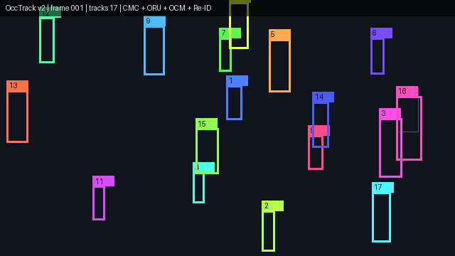
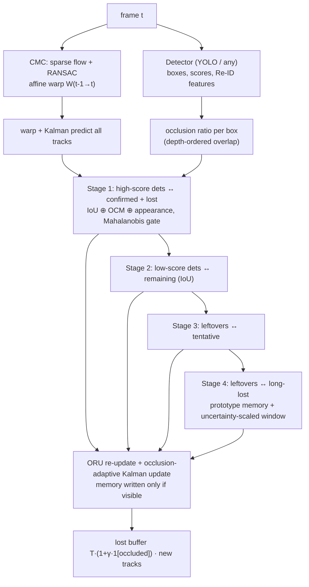

<div align="center">

# OccTrack

### Occlusion-Aware Multi-Object Tracking by Detection

[Dang Truong Minh Le](https://github.com/dangaura-tech)

Mohamed bin Zayed University of Artificial Intelligence (MBZUAI)

[](https://github.com/dangaura-tech/occtrack/actions/workflows/ci.yml)




<sub>OccTrack on a simulated crowd filmed by a panning, shaking camera. Grey boxes are raw
detections (opacity = confidence); coloured boxes are confirmed tracks with ID and trail.
Reproduce with <code>python tools/demo_gif.py</code>.</sub>

</div>

---

## Abstract

Tracking-by-detection breaks down in crowded scenes. When a pedestrian becomes partially
occluded, the detector's confidence drops, the box becomes noisy, the motion model keeps
extrapolating without evidence, and the track is either dropped or taken over by a
neighbour. Moving cameras make this worse, because every object then moves in image space.
**OccTrack** is an online, detector-agnostic tracker that treats **occlusion as a
first-class signal** throughout the pipeline:

1. **Occlusion-adaptive filtering.** A geometric occlusion ratio is estimated for every
   detection from the depth ordering of overlapping boxes. It inflates the Kalman
   measurement noise for weak or occluded boxes, extends the lifetime of tracks that
   vanished *while occluded*, and gates every appearance update.
2. **Observation-centric motion.** When a track is re-associated after a gap, an
   *observation-centric re-update* (ORU) re-runs the filter along a virtual trajectory
   between the last and the new observation. This removes the drift accumulated while the
   target was invisible. An *observation-centric momentum* (OCM) term penalises
   associations that contradict the observed direction of motion.
3. **Camera motion compensation.** Sparse optical flow with RANSAC estimates the global
   affine motion between frames, with detections masked out. Every track state, its saved
   state and its observation history are warped into the new frame.
4. **Occlusion-aware Re-ID memory.** Each track keeps a bank of diverse appearance
   prototypes that is written *only when the target is visible*. A fourth association stage
   recovers long-lost tracks through this memory, inside a spatial window that widens with
   the track's positional uncertainty.

These are combined with high/low-score two-stage association and chi-square motion gating.
The core tracker needs only NumPy and SciPy, runs in real time on a CPU, and comes with
CLEAR-MOT, IDF1 and **HOTA** metrics, MOTChallenge tooling, gap interpolation and a
crowd simulator for controlled ablations.

## Pipeline



## Installation

```bash
git clone https://github.com/dangaura-tech/occtrack.git
cd occtrack
pip install -e .                 # core tracker (numpy, scipy)
pip install -e ".[video,reid]"   # + YOLO detector, OpenCV, torchvision Re-ID
```

An editable install also provides the console commands `occtrack-mot`, `occtrack-eval`
and `occtrack-ablation` (equivalent to the scripts in `tools/`).

## Quick start

```python
from occtrack import OccTracker, TrackerConfig
from occtrack.cmc import SparseFlowCMC  # optional, needs opencv

tracker, cmc = OccTracker(TrackerConfig()), SparseFlowCMC()
for frame, (boxes_xyxy, scores, feats) in zip(frames, detections):
    warp = cmc.apply(frame, boxes_xyxy)  # global camera motion
    for track in tracker.update(boxes_xyxy, scores, feats, warp=warp):
        print(track.track_id, track.xyxy)
```

**Track people in a video** (YOLO detections, CMC on by default, optional Re-ID):

```bash
python tools/track_video.py --source street.mp4 --output street_tracked.mp4 --weights yolov8m.pt --reid
```

### Open-vocabulary tracking: track what you describe

With `--prompt`, detections come from **OWLv2**, an open-vocabulary detector that scores
every image patch against CLIP text embeddings. The categories are whatever you type, not a
fixed training label set:

```bash
pip install -e ".[openvocab]"   # torch + transformers; weights are fetched from the HF hub on first use
python tools/track_video.py --source street.mp4 --prompt "person, bicycle, a dog on a leash"
```

Detections are decoded in `occtrack/detectors/open_vocab.py`: sigmoid scores maximised over
the queries, boxes mapped back from OWLv2's padded-square input, and per-class NMS. Each
category then goes to its own tracker through `MultiClassTracker`, so overlapping objects of
different classes (a cyclist and the bicycle) can never swap identities. IDs stay unique
across classes.

```python
from occtrack.detectors.open_vocab import OpenVocabDetector
from occtrack.multiclass import MultiClassTracker

detector, tracker = OpenVocabDetector(["person", "bicycle"]), MultiClassTracker()
for frame in frames:
    boxes, scores, labels = detector.detect(frame)
    for t in tracker.update(boxes, scores, labels):
        print(t.track_id, detector.prompts[t.label], t.xyxy)
```

## MOTChallenge benchmarks

Download [MOT17](https://motchallenge.net/data/MOT17/) / [MOT20](https://motchallenge.net/data/MOT20/)
to `data/` (no data is included in this repository), then:

```bash
# track with the public detections
python tools/track_mot.py --data data/MOT17/train --config configs/mot17.yaml \
    --out results/mot17_train --filter FRCNN --interpolate 20

# quick evaluation with the built-in HOTA / CLEAR-MOT / IDF1 implementation
python tools/eval_mot.py --gt data/MOT17/train --pred results/mot17_train --filter FRCNN

# official HOTA / CLEAR / Identity metrics via TrackEval
bash scripts/run_trackeval.sh data/MOT17 results/mot17_train MOT17
```

**Tracker throughput** (association + filtering only, on simulated crowds of increasing density):

```bash
python tools/benchmark_fps.py --targets 10 25 50 100 --frames 300 --features
```

**Visualise results** (ID-coloured boxes, trails, optional dashed ground truth):

```bash
python tools/visualize.py --seq data/MOT17/train/MOT17-04-FRCNN \
    --results results/mot17_train/MOT17-04-FRCNN.txt --out vis/MOT17-04.mp4 --gt --scale 0.5
```

## Ablations on synthetic crowds

`tools/simulate_ablation.py` generates three controlled scenarios: a static camera, a
panning and shaking camera, and a dense crowd with simulated Re-ID embeddings that occluders
corrupt. On each, it compares the full tracker with variants that remove one component at a
time. It needs no dataset or GPU:

```bash
python tools/simulate_ablation.py --scenes 5 --frames 300
```

| Variant | Config change |
|---|---|
| OccTrack v2 (full) | `configs/default.yaml` |
| w/o camera motion compensation | `cmc: false` |
| w/o observation-centric re-update | `re_update: false` |
| w/o observation-centric momentum | `momentum_weight: 0` |
| w/o Re-ID memory stage | `reid_stage: false` |
| w/o occlusion-aware buffer | `occlusion_buffer_gain: 0` |
| w/o adaptive measurement noise | `adaptive_noise: false` |
| w/o low-score association | `second_match_thresh: -1` |
| ByteTrack-like baseline | `configs/bytetrack_like.yaml` |

## Repository structure

```
occtrack/
├── occtrack/
│   ├── tracker.py       # OccTracker: 4-stage association + lifecycle management
│   ├── multiclass.py    # class-aware tracking with globally unique IDs
│   ├── track.py         # Track state, ORU, adaptive-noise updates, prototype memory
│   ├── cmc.py           # camera motion compensation (sparse optical flow + RANSAC)
│   ├── postprocess.py   # gap interpolation + temporal smoothing
│   ├── visualize.py     # drawing tracks / trails / ground truth, video rendering
│   ├── kalman.py        # constant-velocity Kalman filter (cx, cy, a, h) + affine warps
│   ├── matching.py      # IoU / OCM / appearance / Re-ID costs, gating, Hungarian
│   ├── boxes.py         # box formats, IoU, occlusion ratio
│   ├── simulation.py    # synthetic crowds: occlusion, camera motion, Re-ID embeddings
│   ├── eval/            # HOTA, CLEAR-MOT, IDF1
│   ├── detectors/       # YOLO, open-vocabulary OWLv2, torchvision Re-ID embedder
│   └── io.py            # MOTChallenge format
├── configs/             # default, MOT17, MOT20, DanceTrack, ByteTrack-like baseline
├── tools/               # track_mot, eval_mot, track_video, visualize, benchmark_fps, simulate_ablation, demo_gif
├── assets/              # README demo media
├── scripts/             # TrackEval wrapper
└── tests/               # unit tests (pytest)
```

## Citation

```bibtex
@misc{le2026occtrack,
  title        = {{OccTrack}: Occlusion-Aware Multi-Object Tracking by Detection},
  author       = {Le, Dang Truong Minh},
  year         = {2026},
  howpublished = {\url{https://github.com/dangaura-tech/occtrack}}
}
```

## Acknowledgements

OccTrack builds on SORT (Bewley et al., 2016), DeepSORT (Wojke et al., 2017),
ByteTrack (Zhang et al., 2022), OC-SORT (Cao et al., 2023), BoT-SORT (Aharon et al., 2022)
and GSI interpolation (Du et al., 2022). HOTA follows Luiten et al. (IJCV 2021) and the
TrackEval reference implementation. Open-vocabulary detection uses OWL-ViT / OWLv2
(Minderer et al., ECCV 2022 / NeurIPS 2023).

## License

MIT
